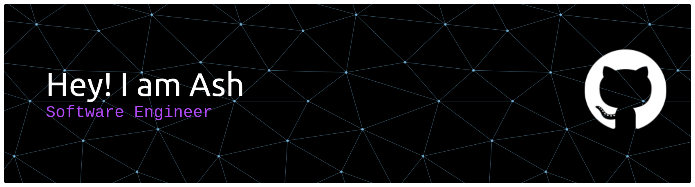

<h1>
  
  Hi, I'm <a href="https://ash-portfoliov3.vercel.app/">Ash</a>!
  
</h1>

**Developer · Web & Games**

- 🌏 Based in **Bohol, Philippines**
- 💼 Currently a **Software Developer at HISD3**, building hospital software such as queue management and helpdesk ticketing systems
- 🤝 **Open to freelance.** You can reach me at **ashgesite25@gmail.com**
- 👨‍💻 All of my projects are on my portfolio: **[ash-portfoliov3.vercel.app](https://ash-portfoliov3.vercel.app/)**

  

---

### 🗂️ What I build

| Lane | Highlights |
|---|---|
| 🌐 **Web** | Hospital systems (queue management, PhilHealth-integrated provider app, IT asset management), business landing pages, an e-commerce capstone |
| 🔌 **IoT** | Server Room Monitor: temperature and humidity monitoring with alerts (ESP32, Arduino, C) |
| 🎮 **Games** | Coming soon |

---

### 🌐 Web Development

  
  
  
  
  
  
  
  
  
  
  
  
  
  

---

### 🎮 Game Development

  
  

---

### 🤖 IoT & Embedded Systems

  
  
  
  

---

### 🧰 Tools

  
  
  
  
  
  
  
  
  
  
  <picture>
    <source media="(prefers-color-scheme: dark)" srcset="https://unpkg.com/@lobehub/icons-static-png@latest/dark/openai.png">
    
  </picture>

---

  
  

